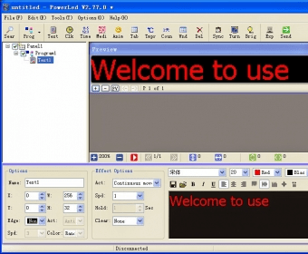
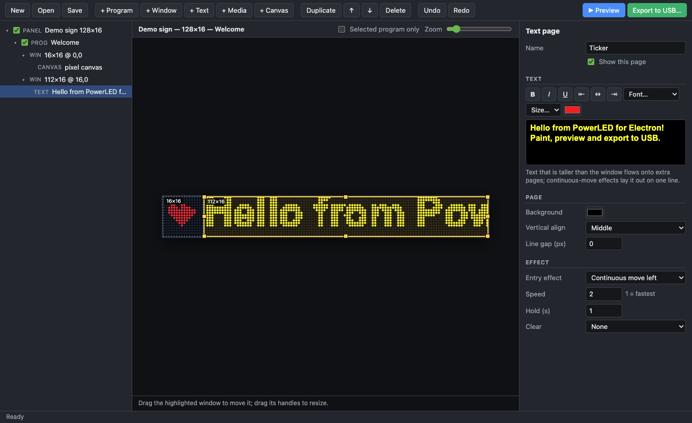
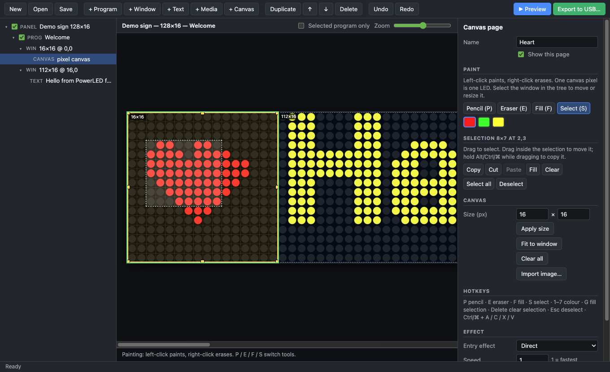

# PowerLED for Electron

An unofficial, cross-platform editor for **PowerLED / TF-series LED signs**: design programs, preview them on a
simulated LED matrix, and export them to a USB stick that the sign's controller plays.

It is a from-scratch reimplementation of the Windows-only *PowerLed* software, written for interoperability and based on
analysing the original program's behaviour and the real files it produces. It runs on macOS, Windows and Linux.

## Note from the Human
I had this old programmable LED scroller sign (model LLDP762-16128RGM if anyone's curious) that's been sitting around my house for a while, and a few months ago I decided to plug it back in and play around with it (to the unbridled delight of my college roommates).
Unfortunately, "play around with it" meant hunting the internet for a Windows XP-era EXE file and pampering it just enough until it ran on my Mac with WINE. It worked, but it was a little clunky to setup and looked like it sorely missed its long-lost friend Clippy.



*"It looks like you're trying to impress your college roommates with a majestic LED sign. Get help with impressing your roommates, or impress your roommates without help?"*


I poked a little at the output LED file to figure out how it worked but things didn't really take off until I heard about [Reverse Engineer Anything](https://github.com/morluto/rea/) for Claude Code. I figured I'd give it a whirl, and the result was truly wild: The entire app, decompiled and rebuilt in Electron. What wild times we live in.

Anyway, while this was mostly just a personal project, I figured I'd put it on GitHub on the off chance someone else has the same oddball LED scroller sign that I have and would appreciate a modern rewrite of the app that works on macOS and Linux. To that person: I see you. You are gonna have the sickest LED sign on the block.

That's all from me. Back to whatever Claude wrote about what this app can do:



> **Status: early / experimental.** The file formats are verified byte-for-byte against real exports (see
> [Testing](#testing)), but this has **not yet been validated on a wide range of physical signs**. Keep a backup of the
> USB stick's contents and try a simple project first. See [Limitations](#limitations).

## Features

- **Editor** – panel → programs → windows → pages tree; drag/resize windows on the preview; rich-text pages (font, size,
  colour, bold/italic/underline, alignment); image pages; per-page entry effect, speed and hold time; program schedule
  (play mode, dates, time of day, weekdays); undo/redo; right-click context menu on the tree.
- **Canvas pages** – paint pixels directly on the preview (one canvas pixel = one LED). Pencil / eraser / fill /
  rectangle-select tools with move, copy, cut, paste and fill, left-click paints, right-click erases, hotkeys, import an
  image into a canvas. To the sign a canvas is just an image.
- **Preview** – LED dot-matrix simulation of the panel, zoomable (`⌘/Ctrl` + scroll or `+` / `-`). ▶ Preview plays all
  enabled programs with the 47 entry effects (approximations; the real ones run in the controller firmware). Colours are
  reduced to the sign's 1-bit-per-colour planes, so the preview matches what gets exported.
- **Export to USB** – writes `POWERLED/<w><h><planes>.TFU`, `POWERLED/LED.TFU` and `POWERLED/Readme.txt`, the same files
  the original software writes. Can take the panel-parameter block from the disk's own `LED.TFR`, remove stale
  programs, and eject the disk when done.
- **File compatibility** – opens and saves the classic `.ledprj` format (`<project ver="2">`) **byte-identically**;
  imports the newer `<led595 version="3">` files best-effort.



## Getting started

Requires [Node.js](https://nodejs.org) 20 or newer.

```sh
git clone <this repository>
cd powerled-electron
npm install
npm start                          # or: npx electron . examples/hello.ledprj
```

Open `examples/hello.ledprj` for a small demo (a painted heart plus a scrolling text window).

### Making a sign play something

1. Build your project: add programs, windows, text / image / canvas pages. Tick the programs you want.
2. Press **Export to USB…**, pick the USB stick (formatted FAT32 – the controller reads nothing else).
3. Choose the options in the dialog and press **Export**, then **Eject USB Disk**.
4. Plug the stick into the controller. The screen shows `USB`, a percentage, then `OK!` when copying is done.

If the stick contains a `LED.TFR` (the controller writes one when you plug an empty stick into it), tick
*Use the panel parameters from this disk's LED.TFR* so the export matches your sign's real scan/frequency settings.

### Keyboard & mouse

| | |
|---|---|
| Tree | right-click for Add / Duplicate / Move / Tick / **Delete** |
| Preview | `⌘/Ctrl` + scroll or `⌘/Ctrl` + `+` `-` to zoom, `⌘/Ctrl` + `0` to fit |
| Canvas | left-click paints, right-click erases |
| Canvas tools | `P` pencil · `E` eraser · `F` fill · `S` select · `1`–`7` colour |
| Selection | drag to select · drag inside to move (hold `Alt`/`Ctrl`/`⌘` to copy) · `⌘/Ctrl`+`C` `X` `V` · `G` fill · `Delete` clear · `Esc` deselect · `⌘/Ctrl`+`A` select all |
| Project | `⌘/Ctrl`+`N` `O` `S`, `⌘/Ctrl`+`Z` undo, `⌘/Ctrl`+`Shift`+`Z` redo, `⌘/Ctrl`+`E` export, `⌘/Ctrl`+`P` preview |

## Limitations

- **Page types.** Only **text**, **image** and **canvas** pages are exported. Date/Time, Clock, Countdown,
  Temperature, Table and Animate pages are kept in the project and shown approximately in the preview, but skipped on
  export (the dialog lists what was skipped), because they use different page records that are not decoded yet.
- Window borders and program "custom frame" images are not exported.
- Image pages are thresholded per colour channel (≥ 128 = on). Draw at the sign's native size for pixel-exact results.
  Animated GIFs use their first frame. The media "remove colour" settings are stored but not applied.
- Text is rendered with the host platform's fonts, so glyph shapes differ slightly from Windows.
- Canvas pixels are stored inline in the `.ledprj` (an extra `<cvpng>` tag); the original Windows software ignores it
  and shows an image page with no file.
- Tested for **USB export only**. Sending over serial / LAN / Wi-Fi / HID is out of scope.

## Testing

```sh
npm test
```

The suite is pure Node (no Electron needed) and covers the XML/RTF/project model (including byte-exact round trips),
the `.TFU` builder, the panel-parameter layout and the eject logic.

The strongest tests rebuild **real `.TFU` exports** produced by the original software and compare every meaningful
byte. Those files belong to the people who made them, so they are not in this repository; point the suite at a folder
containing your own to enable those tests (without it they are skipped):

```sh
POWERLED_SAMPLES=/path/to/folder npm test
```

`test/shot.cjs` is a small headless harness (screenshots and scripted UI runs through the real preload/IPC code) that
was used to exercise the app: `npx electron test/shot.cjs <project.ledprj|-> <out.png> ["js to run"]`.

## How it works

| Path | What |
|---|---|
| `main.js`, `preload.js`, `ipc.js` | Electron shell, menus, file / USB IPC |
| `usb-eject.js` | Works out which volume to eject (never system volumes) |
| `src/xml.js` | Tiny XML reader/writer (the RTF payload survives untouched) |
| `src/project.js` | `.ledprj` model (v2 native, v3 import) and templates |
| `src/rtf.js` | RTF parser / generator for page text |
| `src/render.js`, `src/effects.js` | Rasteriser, entry effects, playback, LED dot renderer |
| `src/usb.js` | `.TFU` builder |
| `src/app.js`, `index.html`, `styles.css` | UI |
| `docs/FORMATS.md` | The reverse-engineered file formats, with each field marked verified or assumed |

### Background

The formats were worked out by inspecting the original program's behaviour (disassembly for interoperability) and by
comparing the files it writes. [`docs/FORMATS.md`](docs/FORMATS.md) documents the `.ledprj` project format and the
`.TFU` / `LED.TFR` USB files, including which parts are verified against real samples and which are still assumptions.
**No code or binaries from the original software are included in this repository.** Only interoperability facts are:
file layouts, default parameter values, effect names and the stock `Readme.txt` the original writes to USB sticks.

## Contributing

The most valuable contribution is **sample data**: small, controlled exports from the original software (change one
setting at a time: effect, speed, hold, colours, a clock page…) help decode the remaining page types and settle the
open questions listed in `docs/FORMATS.md`. Bug reports with a sign model and firmware version are also very helpful.

## Disclaimer

This project is unofficial and not affiliated with or endorsed by the makers of PowerLED / TF controllers. "PowerLED"
and related names belong to their owners. It is provided as-is with no warranty; exporting to a controller is done at
your own risk, so keep a backup of the USB stick first.

## License

[MIT](LICENSE)
